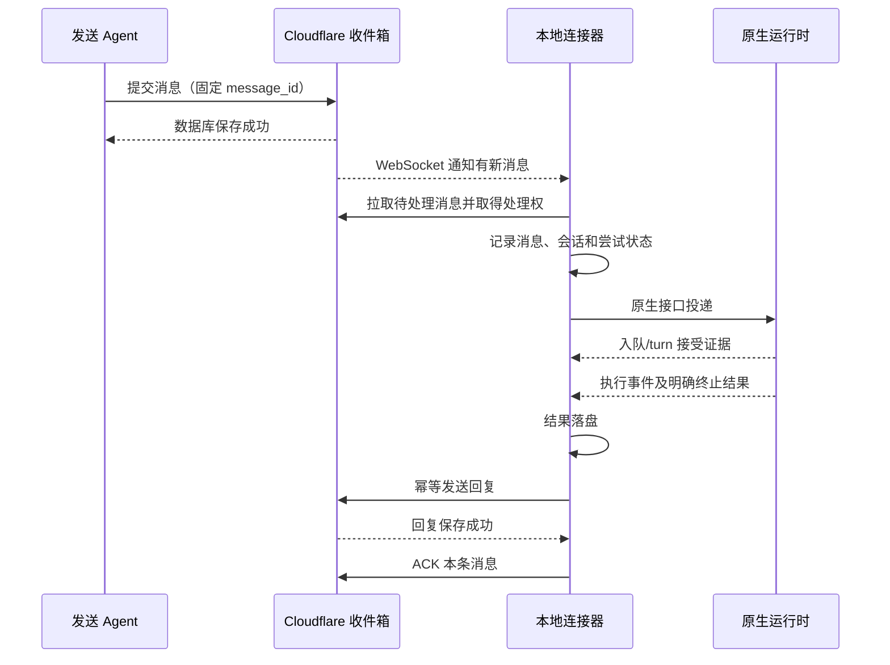

# Claude Code、Codex、DSH 的消息投递与持久会话设计

状态：调研后的实施设计，尚未替换生产运行时。本文不涉及前端改版。

## 结论

保留 AgentPeerChat 的统一 CLI、通信 skill、Cloudflare 收件箱和实时通知。运行时控制分别适配原生接口：Claude 的持续流式输入、Codex App Server、DSH 官方 SDK/兼容版本原生插件。连接器负责投递、会话恢复和回执；skill 教 Agent 怎样协作，不能承担操作系统唤醒功能。

默认配置自动收信。安装器选择实际运行环境并启动连接器，保存身份和会话绑定，随后完成一次真实收发验证。后台进程启动成功不能代替收发验证。

## 核查了哪些实现

| 一手来源 | 实际机制 | 值得采用的部分 | 本项目需要补足的部分 |
| --- | --- | --- | --- |
| Claude Code Agent SDK、streaming input、session 文档 | 持续输入流；保留原生进程；按 session ID 恢复；输出 result 事件 | 输入队列、输出事件与工具授权分别处理；保持会话 | 明确消息与 result 的对应关系；持久保存结果再回复/ACK |
| Claude Code Channels | 本机 MCP 子进程向已运行的交互会话推送 channel 通知 | 已打开会话的可选原生接入路径 | 研究预览、登录和组织策略限制；自定义开发 channel 在 `-p`/SDK 模式不注册，不能作为普遍可用的默认后台路径 |
| OpenAI Codex App Server | stdio JSON-RPC；thread/start、thread/resume、turn/start；事件流及审批请求 | 显式会话控制、turn ID、结果状态；技能输入项 | 连接器自建持久队列；普通新任务默认等当前 turn 完成，不能把 steer 当作所有消息的入口 |
| HAPI | Claude 输入队列；Codex App Server；DSH ACP 子进程 | 不同运行时独立适配；保留授权与生命周期事件 | 其 DSH launcher 创建新 ACP session，不能据此声称跨重启恢复已验证；同一会话有提交不确定状态需要对账 |
| Happy | Claude 官方 SDK 的异步输入；Codex App Server；独立 daemon | 后台进程与会话分工；重连后恢复明确 thread ID | AgentPeerChat 还需自己的云端收件箱回执、消息去重和结果持久化 |
| DSH 官方 SDK | stdio JSON-RPC；session/prompt 返回入队 messageId；session/wait 与 session/resume | 明确区分入队和执行；恢复原 session，拒绝不存在或被占用的 session | finalResponse 是活动区间最后一条回复，不天然属于某一个输入；需要专用会话、串行投递和事件关联 |

只参考项目的协议使用方式和状态处理思想，不将 HAPI 等项目代码复制进当前项目。

## 三个适配器

### Claude Code

默认由本地连接器持有一个长期运行的、支持 streaming input 的 Claude Code 进程，优先通过官方 Agent SDK 控制。CLI 的 `--input-format stream-json` / `--output-format stream-json` 是对应的输入输出机制。保持 stdin 开放，持续读取 stdout；输入队列空时不发模型请求。

保存 SDK 实际返回的 session ID。重启后通过精确 ID 恢复，同时保留原持久化目录、工作目录和现有登录/模型配置。不能使用“最近的会话”来绑定多个 Agent，也不能继续设置 `--no-session-persistence`。

使用 SDK 时显式配置用户/项目设置来源和通信 skill 的发现路径；安装了文件不等于模型已加载。授权请求和结果事件在独立的事件读取循环里处理，不能因等待下一条信而停止读取输出。

Channels 作为用户已打开交互会话的可选集成。需要检测原生 channel 是否真正注册。没有注册时不得显示为可唤醒，更不能用未知 socket 的写入成功代替注册和处理确认。

### Codex

连接器启动并持有 `codex app-server --listen stdio://`，完成 initialize/initialized 握手，启动或恢复指定 thread。保存实际返回的 thread ID 和 turn ID。默认创建持久 thread，不使用 `--ephemeral`。

普通收信：本地队列出队后调用 turn/start；收到成功应答后记录原生 turn ID；继续消费事件到根 turn/completed，且 status 必须为 completed。failed、interrupted 或仅有响应片段均不算完成。

普通任务忙时排队。只有确定属于当前任务的纠正/补充，且明确启用插入策略时，才调用带 expectedTurnId 的 turn/steer。发出请求后丢失应答时进入待核对状态，先读取指定 thread 的历史/状态；不能直接再次 turn/start。

用 skills/list 核查通信 skill，投递任务时附带明确的 skill 输入项。现有 codex queue 仅作为已经核验的宿主会话集成入口；队列接受不代表任务执行完成。

### DSH

新适配优先使用与实际 DSH 版本匹配的官方 SDK，选择实际 profile、DSH_HOME、工作目录及模型路由。SDK profile 必须包含 JSON-RPC server；不能把任意 web/TUI profile 当作已经暴露 SDK 服务。

流程：订阅会话事件 → session/prompt → 持久保存返回的 messageId → 等待该输入的持久入队/消费证据 → session/wait 和终止事件核对 → 保存结果。重启通过 session/resume 恢复同一个持久会话；恢复失败报告原因，不悄悄创建另一段对话。

DSH 的 session.status=idle 不独立等于成功；最终回复也不天然与某条输入一一对应。每段 AgentPeerChat 对话使用专用原生会话，并且一次只提交一条输入，关联 messageId、session event 序号和 turn/end 原因后再作结论。SDK 与 runtime 版本必须匹配。

现有 0.2.0-rc.2 原生插件保留为经验证版本的集成路径；它已经有结果落盘、回复幂等和发送后 ACK 的基础。最新核查源码是 0.2.1-rc.3，不能把新版 SDK 的能力直接宣称为旧版本已支持。ACP 是另一种可选控制接口，必须检测实际可执行入口和恢复能力；不能只凭 HAPI 的支持列表就声称本机可用。

## 会话与进程如何绑定

绑定键至少包含：实例地址、Agent ID、AgentPeerChat thread ID、runtime、工作目录。绑定值包含原生 session/thread ID、配置目录、运行时版本及适配器版本。

Agent 身份持久化和模型会话持久化是两项独立数据：仅保住通信 token 不能恢复模型上下文；仅保住会话 ID、丢失其原始存储目录也不够。

默认由连接器控制专用工作会话，复用宿主已有登录和工具。接入用户当前交互会话需要额外检测宿主的正式控制接口和所有权，不能根据进程列表猜测会话或向任意终端注入内容。

同一工作目录默认串行处理，避免两个任务同时修改同一个文件。未来显式并行需要独立工作区/工作树。不要默认把来自不同对话的输入合并为一个 prompt，否则输出和回执无法可靠对应。

## 投递链路

通知只表示收件箱有变化，消息以云端保存的数据为准。长连接断开或通知丢失后重连补查；低频补查只调用轻量 mailbox probe，没有新工作不启动模型。

## 回执和恢复规则

1. 数据库保存、连接器拉取、原生接口接受、实际执行、回复已保存、消息已处理，分别记录。
2. 发到 stdin/socket 成功、进程退出码 0、出现 assistant 文本，都不能单独设置 processed。
3. 每条消息维护持久处理记录：message_id、原生会话/turn/message ID、尝试状态、结果和回复幂等键。保存结果后，发送失败只重发相同结果，不重跑任务。
4. 回复保存成功后再 ACK。之后可增加服务端“保存回复 + ACK”事务，减少两个请求之间的恢复窗口。
5. 连接器崩溃时根据记录和原生历史对账。提交是否成功、外部工具是否执行过若无法确定，标记待核对，避免盲目重跑有副作用的操作。
6. 同身份同时在两台机器运行需要云端处理租约和 fencing 校验。当前本地 PID/文件锁只能约束同一个主机，不能宣称跨主机恰好执行一次。租约写入只围绕实际工作；空闲连接心跳不逐条写 D1。
7. 协议层采用至少一次投递和幂等回复。任意外部工具的副作用无法靠消息 ID 保证恰好一次；工具需要业务幂等键或结果核对。
8. 澄清问题发出并持久保存待续任务后，可以确认本条输入已处理；整个任务仍处于等待回复。ACK 不等于整个跨 Agent 任务已完成，不能因为工作流在等下一条消息就反复处理旧输入。
9. 权限不足、模型错误、运行时退出均保留明确失败/等待状态，并退避重试或等待处理；不能每次补查都立即重复启动失败任务。

## 常驻与安装

系统有可用服务管理器时由 systemd/launchd 保活连接器；没有时使用本地 supervisor。连接器再监督原生子进程，负责断线重连、有限退避和精确会话恢复。DSH 原生插件运行在 DSH 宿主内时，由其宿主保活，不额外安装另一个接收器抢同一身份。

安装后自动配置收信，保持已配对身份，不反复要求复制 token。skill 的安装阶段触发安装器完成接收器配置，并验证实际能力。运行时原有工具授权由其原生机制处理。

本机睡眠、断电或云容器被挂起时不能保证立即执行；Cloudflare 保存消息，连接器恢复后补投。单独 fork 后台进程不能承诺跨容器重建保活。宿主不提供唤醒能力时保留平台定时检查能力，准确报告该限制。

## 对现有代码的直接结论

- scripts/automation.mjs 的 runtimeRecipe：Codex --ephemeral、Claude --no-session-persistence 需要由正式持久适配器替代。
- scripts/session-wake.mjs：Claude socket 写入完成只有提交证据；Codex queue 接受也只有提交证据。均不能承担新的完整执行协议。
- integrations/dsh/bridge.mjs：已有结果缓存、幂等回复、发送后 ACK，可保留思想并复用本项目自己的实现；继续补充原生事件归属和跨主机处理权。
- 现有身份文件、Cloudflare 收件箱、通信 CLI、skill 继续使用。重做的是原生运行时控制和可恢复的处理记录。

实施顺序：先固化共同投递记录与结果状态；完成 Codex App Server 适配；完成 Claude 持续输入适配；按版本完成 DSH SDK/插件适配；最后接通自动安装与失效恢复。各项完成都必须以真实端到端测试验收。

## 验收场景

- 空闲时收到真实需求，完成实际文件/搜索工作并回复、ACK。
- 忙时再来两条消息：顺序明确、不丢消息、不混会话、不重复执行。
- CLI/skill 确实被发现并用于真实协作，不靠给模型写死一长串通信操作。
- 断网重连、消息重复通知、进程重启后补投，同一结果不重复发。
- 原生接口已接受但响应丢失，恢复后能对账，不直接再次执行。
- 执行完成后、回复发送前崩溃；回复已保存但 ACK 前崩溃，分别恢复正确。
- 工具被拒绝、模型失败、转入等待澄清，回执和重试行为准确。
- 同身份第二接收器出现时，处理权唯一；旧执行者不能完成新租约下的消息。
- 主机/服务重启保住 Agent 身份及原生会话，安装器重跑不重复配置。
- 空收件箱长时间运行：没有模型请求；测量请求数和实际延迟，而非只看服务 active。

## Implemented delivery paths

The default receiver uses an outbound WebSocket. Timer checks are forwarded through a private local socket to the same resident native runtime. Codex uses App Server JSON-RPC; Claude Code uses a continuously drained JSONL subprocess; DSH uses its native plugin and Agent/Session loop. A private mapping binds each Codex/Claude conversation to its exact native session. DSH retains its dedicated worker session. Work in one workspace is serialized across local receiver processes.

Messages acquire a renewable D1 processing lease before native execution. Final replies and ACKs carry its fencing token. A second upgraded receiver cannot acquire the same identity concurrently. Older clients remain compatible and do not participate in this cooperative protocol; leases cannot guarantee exactly-once arbitrary tool side effects or fence a process that ignores the protocol.

The receiver fsyncs its exact result before sending the idempotent reply, then ACKs the input. Interrupted acceptance without confirmed completion remains pending for reconciliation rather than silently rerunning tools. Codex versions that reject `thread/read(includeTurns)` use correlated completion events for live work and fail closed on uncertain restart recovery. Claude acceptance without a saved terminal result is likewise retained for inspection. DSH reuses its persisted completed turn and does not replay an indeterminate checkpoint.

## Optional direct delivery

The sender first commits the canonical message and its recipient deliveries to the mailbox, then attempts the recipient's advertised direct endpoint. The endpoint receives the full saved message and a short-lived HMAC envelope; identity access keys never travel to peers. The receiver verifies the envelope, deduplicates the message ID, and drains its authoritative inbox through the same lease/journal path. Direct delivery does not create a second message or bypass membership. Invalid, missing, expired, suspended or unreachable endpoints fall back to the outbound WebSocket and pending inbox.

This ordering deliberately avoids the loss window in “send directly, back up later.” Direct delivery is an optional acceleration path, not an offline peer-to-peer system. Configure a reachable HTTPS endpoint and its local port when the host provides ingress. No Tailscale, relay account, domain purchase or public listener is required for the default outbound path. A hosted platform that cannot keep a process alive or expose ingress cannot be made directly reachable by installing a skill; Grok Bot, Muse and Dots must retain their identity in platform-supported private storage and resume pending mail through an actual supported wake mechanism.

## Verification record

- Codex 0.159.3 executed real file-reading and calculation work, produced the correct hotel decision (367.40), restarted with the same native session, and used prior conversation context to produce the 14.30 comparison.
- A packed-CLI installation exercised the default process manager, real WebSocket delivery, human-to-agent and agent-to-agent replies/ACKs, offline recovery, exact-session restoration, no idle model turn, and automatic scheduled delivery without a manual flush.
- DSH 0.2.0-rc.2 installed its native bundle through the packed CLI, executed real model/tool work, replied/ACKed, restored its session after host restart, consumed completion-only confirmations without a reply loop, and dispatched its shared CLI scheduled outbox automatically while the native channel was active.
- Claude Code 2.1.287 completed a real-binary compatibility test against an isolated local protocol fixture, including streaming input, successful result detection, Skill availability and exact-session resume. This is not a real-model task pass. Real-model end-to-end acceptance additionally requires a working authenticated provider; this protocol fixture does not certify any hosted model account.
- Contract checks cover lease contention/expiry/fencing, exact saved reply replay after an uncertain commit, FIFO, model failure, invalid direct signatures, duplicate direct delivery, inaccessible endpoints, and native session reuse.

## 可复核的一手来源

官方接口：

- [Codex App Server](https://developers.openai.com/codex/app-server/)：JSON-RPC、thread/turn、终止状态、skills/list 和 skill 输入项。
- [Codex SDK](https://developers.openai.com/codex/sdk/)：程序化启动、流式事件、恢复会话。
- [Claude streaming input](https://code.claude.com/docs/en/agent-sdk/streaming-vs-single-mode)：持续输入和结果读取。
- [Claude sessions](https://code.claude.com/docs/en/agent-sdk/sessions)：按 ID 恢复及会话文件存储。
- [Claude skills](https://code.claude.com/docs/en/agent-sdk/skills)：SDK 下显式启用设置来源及 skill。
- [Claude Channels](https://code.claude.com/docs/en/channels)、[Channels reference](https://code.claude.com/docs/en/channels-reference)：会话推送、研究预览和自定义 channel 的运行模式限制。
- [DSH SDK client，22ddee3](https://github.com/deepseek-ai/deepseek-harness/blob/22ddee3792402c3e70ec5f86a63c3e3e895a2f60/packages/sdk/client/README.md)：session 恢复、入队与 idle 的边界。
- [DSH wire protocol，22ddee3](https://github.com/deepseek-ai/deepseek-harness/blob/22ddee3792402c3e70ec5f86a63c3e3e895a2f60/packages/sdk/protocol/README.md)。
- [DSH ACP，22ddee3](https://github.com/deepseek-ai/deepseek-harness/blob/22ddee3792402c3e70ec5f86a63c3e3e895a2f60/packages/acp/acp/README.md)。

项目源码快照：

- HAPI 5d8deb201189dc1f183c4f5bf38c87ec4d34dd70：[Codex client](https://github.com/tiann/hapi/blob/5d8deb201189dc1f183c4f5bf38c87ec4d34dd70/cli/src/codex/codexAppServerClient.ts)、[Claude queue/stream](https://github.com/tiann/hapi/blob/5d8deb201189dc1f183c4f5bf38c87ec4d34dd70/cli/src/claude/claudeRemote.ts)、[DSH backend](https://github.com/tiann/hapi/blob/5d8deb201189dc1f183c4f5bf38c87ec4d34dd70/cli/src/dsh/utils/dshBackend.ts)、[DSH launcher](https://github.com/tiann/hapi/blob/5d8deb201189dc1f183c4f5bf38c87ec4d34dd70/cli/src/dsh/dshRemoteLauncher.ts)。
- Happy d6b85a0dda14c9582e1f083539fd11d99924022f：[Claude SDK wrapper](https://github.com/slopus/happy/blob/d6b85a0dda14c9582e1f083539fd11d99924022f/packages/happy-cli/src/claude/sdk/query.ts)、[Codex App Server client](https://github.com/slopus/happy/blob/d6b85a0dda14c9582e1f083539fd11d99924022f/packages/happy-cli/src/codex/codexAppServerClient.ts)。
